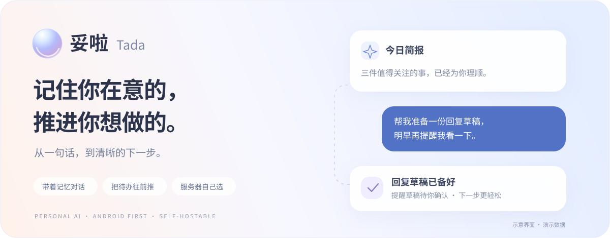
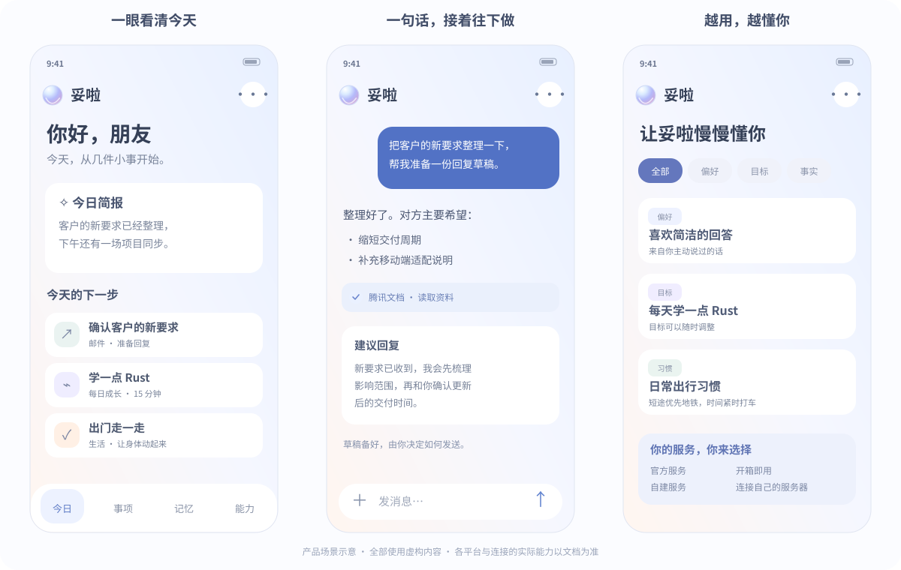

<p align="center">
  
</p>

<h1 align="center">Tada · 妥啦</h1>

<p align="center">
  A personal AI companion with memory, tools, and a sense of what comes next.<br />
  Android first. Use the official service, or host the backend on your own machine.
</p>

<p align="center">
  <a href="README.md">简体中文</a> ·
  <a href="#get-started">Get started</a> ·
  <a href="docs/selfhost.md">Self-hosting guide</a> ·
  <a href="https://github.com/lihailong00/tomorrow-ai/issues">Feedback</a>
</p>

Tada connects the small things scattered across your day: a conversation worth remembering, an incoming request, a reply to prepare, or fifteen minutes for something you want to learn. **Keep the context, prepare the next step, and leave the decisions to you.**

<p align="center">
  <a href="docs/assets/readme/product-preview.svg"></a>
  <br /><sub>Illustrations with fictional sample data, not runtime screenshots. Available capabilities depend on the platform and connected service.</sub>
</p>

## What you can do

| | In Tada |
| --- | --- |
| **Talk naturally** | Genuine streamed replies, visible tool activity, voice input, image understanding, Markdown tables, and code cards. |
| **Keep useful context** | Automatic memory of explicitly stated preferences, goals, and facts, with sources and controls to edit, undo, forget, or disable automatic additions. |
| **Move a task forward** | Discover task candidates from saved, authorized conversations and imported material. Accept a task, prepare a draft, and track progress or follow-ups. |
| **Make a little progress daily** | Opt in to suggestions based on your goals and time budget. Choose what to do, receive completion feedback, or take a day off. |
| **Connect your tools** | Use authorized map, travel, document, email, and other services. Tools are discovered dynamically; external writes require an explicit confirmation flow. |
| **Share selectively** | Select individual questions and answers, copy text, or preview a locally generated conversation image before opening the system share sheet. |
| **Choose models and track usage** | Configure providers and server-side keys in the admin UI, test actual connectivity, and review usage and cost estimates by model and date range. |

Existing adapters include Amap, Baidu Maps, DiDi, Fliggy, Tencent Docs, Tencent Meeting, Yuque, Notion, Memos, QQ / 163 / 126 Mail, TickTick, and selected lifestyle services. The connected server must support and enable an adapter, and each provider has its own authorization and availability requirements. See [personal connections](docs/personal-mcp.md).

You can also [import official ChatGPT, Claude, and DeepSeek conversation exports](docs/ai-history-import.md). Preview the import before confirming it.

## Your server is your choice

The client defaults to the official service. For self-hosting, deploy the backend, configure providers in `/admin/`, and connect the client using your instance address or its connection QR code.

Self-hosted business data does not pass through the official business server. Content sent to a configured model, speech, or application provider still goes to that provider; self-hosting does not imply fully offline processing. API keys stay on the selected server and are not embedded in the APK. Failed connections do not silently fall back to another instance.

## Get started

### Android

Tada is an early development preview. No GitHub Release has been published yet. Follow the [Android build guide](apps/mobile/README.md) to build from source. With Node.js, a JDK, and Android SDK configured on Windows:

```powershell
./scripts/Build-Android.ps1 -BuildType Release -Compact
```

The phone APK is published locally as `artifacts/apk/tada-latest.apk`. Emulator builds use `-Target Emulator`. Read the [development storage policy](docs/development-storage-policy.md) before building.

### Self-host the backend

Requires Docker Engine and Docker Compose v2, plus access to this repository.

```sh
git clone https://github.com/lihailong00/tomorrow-ai.git
cd tomorrow-ai
docker compose -f infra/selfhost/compose.yaml build
docker compose -f infra/selfhost/compose.yaml up -d
```

Open `http://localhost:8080/admin/` on the deployment machine. Obtain the one-time setup token:

```sh
docker compose -f infra/selfhost/compose.yaml exec server cat /data/config/setup-token
```

Create the instance owner, choose a model provider, enter and test your key, then connect the client. The admin UI starts without a model key; self-hosted instances support email/password accounts without requiring SMS.

The default listener is loopback-only. Follow the [self-hosting guide](docs/selfhost.md) for phone access, HTTPS, registration policy, backups, and recovery.

## Built with

- **Mobile:** React Native / TypeScript, with Kotlin platform adapters.
- **Windows preview:** shared React UI and Tauri 2 / Rust.
- **Backend:** Rust, Axum, SQLx, and a separate durable Worker.
- **Agent loop:** an independent TypeScript + Pi service behind the Rust business boundary.
- **Data:** PostgreSQL or SQLite; optional Temporal and S3-compatible storage.
- **Administration:** a Web UI for providers, connections, users, usage, and encrypted backups.

See the [development guide](docs/development.md), [Agent service](services/agent/README.md), and [streaming protocol](docs/chat-streaming.md).

## Project status

Android and Windows are preview clients. iOS and native HarmonyOS adapters, macOS / Linux desktop validation, public release packages, production signing, and update distribution are still planned. Running the Android APK on a compatible HarmonyOS device does not constitute a native HarmonyOS release.

We welcome [issues](https://github.com/lihailong00/tomorrow-ai/issues) and contributions around integrations, mobile interaction, platform adapters, self-hosting, and documentation. Include a reproducible case and redact private content and credentials.

The original Tada code is made available under [PolyForm Noncommercial 1.0.0](LICENSE). Noncommercial use, modification, and distribution are permitted under its terms. Commercial use requires separate permission. Third-party components and marks are subject to their respective terms and rights.
