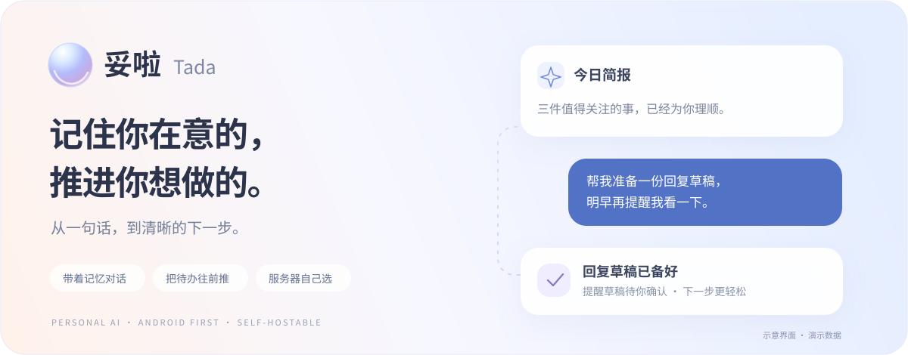
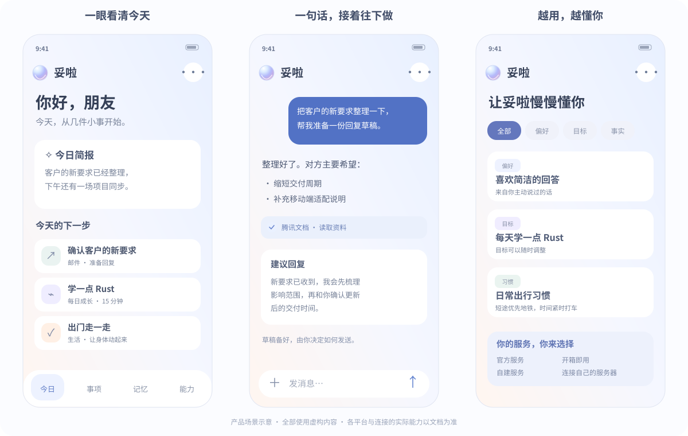

<p align="center">
  
</p>

<h1 align="center">妥啦 · Tada</h1>

<p align="center">
  一个有记忆、能用工具、陪你把事情往前推进的个人 AI 助手。<br />
  Android 优先，支持连接官方服务，也支持把后端部署在自己的机器上。
</p>

<p align="center">
  
  
  
  
</p>

<p align="center">
  <a href="#先看一眼妥啦">界面预览</a> ·
  <a href="#开始使用">开始使用</a> ·
  <a href="docs/selfhost.md">自建部署</a> ·
  <a href="#参与一起做">参与贡献</a> ·
  <a href="README.en.md">English</a>
</p>

---

工作消息、临时想法、学习计划，常常散在不同的地方。妥啦希望帮你把它们接起来：**记住你明确说过的重要信息，从已授权的资料中发现待办，准备好下一步，让你来做决定。**

> “把客户的新要求整理一下，帮我准备一份回复。”<br />
> “根据我已有的待办，安排今天能做完的三件事。”<br />
> “我每天只有十五分钟，帮我一点点学会 Rust。”

## 先看一眼妥啦

<p align="center">
  <a href="docs/assets/readme/product-preview.svg"></a>
</p>

<p align="center"><sub>点击配图可放大。以上为产品场景示意，使用虚构内容；不是运行截图。各平台和连接的实际能力以对应文档为准。</sub></p>

## 可以一起做些什么

| | 在妥啦里 |
| --- | --- |
| 💬 **自然地聊，实时看到进展** | 真实流式回复，展示正在使用的工具；支持语音输入、图片理解、Markdown 表格和代码卡片。 |
| 🧠 **带着记忆继续聊** | 自动整理你明确说过的偏好、目标和事实。记忆有来源，可查看、修改、撤销、忘记，也可关闭自动新增。 |
| ✅ **从消息，到下一步** | 从已授权并保存的对话、邮件或通知资料中发现事项候选。收下待办、准备回复、记录进展和后续跟进。 |
| 🌱 **每天前进一点点** | 开启每日成长，按你的目标和时间生成建议。自己选择要做的事，完成后获得成长反馈，也可以休息或跳过。 |
| 🔌 **连接常用应用** | 在平台授权范围内查询地图、出行、文档、邮箱等资料。工具可动态发现，涉及外部写入的操作走明确确认流程。 |
| 🖼️ **把有用的对话带走** | 多选提问和回答，复制文字或生成本地分享长图，预览后再交给系统分享。 |
| 🎛️ **模型与费用看得见** | 后台选择供应商、填写服务端 Key 并实际测试连接。手机可按模型、功能和时间段查看用量与费用估算。 |

事项、每日成长和对话分享的细节分别见 [个人事项](docs/personal-todos.md)、[每日成长](docs/daily-growth.md) 和 [多选分享](docs/conversation-sharing.md)。

### 连接你已经在用的服务

| 场景 | 已提供适配的服务举例 |
| --- | --- |
| 地图与出行 | 高德地图、百度地图、滴滴出行、飞猪 |
| 文档与协作 | 腾讯文档、腾讯会议、语雀、Notion、Memos |
| 邮箱与清单 | QQ 邮箱、163 / 126 邮箱、滴答清单 |
| 生活与内容 | 麦当劳、瑞幸咖啡、微信读书、QQ 音乐 |

入口以所连服务器实际支持、启用的服务为准；不同平台需要个人凭据、应用授权或相应额度，能力范围也不同。查看 [个人连接与授权说明](docs/personal-mcp.md)。微信等手机应用可通过用户授权的通知与系统分享导入资料，不代表读取其完整聊天记录。

还可以 [导入 ChatGPT、Claude、DeepSeek 的历史对话](docs/ai-history-import.md)，先预览，再确认导入，继续检索和使用过去的想法。

## 默认简单，也可以自己掌控

| | 官方服务 | 自建服务 |
| --- | --- | --- |
| 开始方式 | 客户端默认连接，按提示注册使用 | 部署后端，在管理后台完成初始化 |
| 模型配置 | 由服务运营方管理 | 选择供应商，填写自己的 API Key |
| 手机连接 | 使用默认服务地址 | 输入自己的地址或扫描后台连接二维码 |
| 数据保存 | 在官方实例中保存 | 在自己选择的实例中保存 |

**自建实例的业务数据不经过官方业务服务器。** 使用第三方模型、语音或应用服务时，相应内容仍会发送给你配置和授权的供应商；自托管不等于全离线。客户端会绑定所选实例，连接失败时不会擅自把请求转到其他服务器。

模型 API Key 留在服务端，不写进 APK。应用授权与模型供应商配置分开，资料导入和设备权限由用户选择。备份、恢复及各类配置的保存范围见 [自建部署](docs/selfhost.md)。

## 开始使用

### Android 客户端

目前为开发预览，尚未发布 GitHub Release。可以按 [Android 构建说明](apps/mobile/README.md) 从源码生成安装包。请在客户端的「连接服务器」中填写你自己的服务地址。

已准备好 Node.js、JDK 和 Android SDK 的 Windows 开发者，可在仓库根目录运行：

```powershell
./scripts/Build-Android.ps1 -BuildType Release -Compact
```

手机包输出到 `artifacts/apk/tada-latest.apk`。模拟器需要单独构建 `-Target Emulator`，详情见客户端文档。构建前请阅读 [开发存储约定](docs/development-storage-policy.md)。

### 把后端部署到自己的机器

需要 Docker Engine 和 Docker Compose v2。自建首版使用 PostgreSQL、Rust API / Worker、Pi 服务与 Web 管理后台。

```sh
git clone https://github.com/lihailong00/tomorrow-ai.git
cd tomorrow-ai
docker compose -f infra/selfhost/compose.yaml build
docker compose -f infra/selfhost/compose.yaml up -d
```

在部署机器访问 `http://localhost:8080/admin/`。读取一次性安装凭证：

```sh
docker compose -f infra/selfhost/compose.yaml exec server cat /data/config/setup-token
```

然后创建实例所有者 → 选择模型供应商 → 填入 Key 并校验 → 连接手机。首次启动无需先准备模型 Key；自建可使用邮箱密码账号，不强制接入短信。

默认只监听服务器回环地址。手机连接、公网 HTTPS、注册策略和数据备份请按 [完整自建指南](docs/selfhost.md) 配置。源码克隆需要具有当前仓库的访问权限。

## 为长期使用而搭建

| 层 | 技术与职责 |
| --- | --- |
| Android | React Native / TypeScript，Kotlin 适配录音、权限、安全存储、分享等系统能力 |
| Windows 预览版 | React + Tauri 2 / Rust，共享客户端协议层，见 [桌面说明](docs/windows-client.md) |
| 业务后端 | Rust、Axum、SQLx；负责身份、资料、记忆、事项、工具网关和持久化 |
| Agent 执行 | 独立 TypeScript + Pi 服务；模型执行循环与 Rust 业务边界分开 |
| 数据与任务 | PostgreSQL / SQLite；独立 Rust Worker；Temporal、S3 兼容存储按需配置 |
| 管理后台 | Web 页面管理模型、语音、连接、用户、用量与加密备份 |

```text
Tada/
├── apps/mobile       Android 客户端与平台适配
├── apps/client       共享 Web / 桌面界面
├── apps/desktop      Tauri 桌面外壳
├── apps/admin        服务管理后台
├── crates            Rust API、领域、连接器、文件与 Worker
├── services/agent    Pi 执行服务
├── packages          客户端共享协议与能力
└── infra/selfhost    自建部署入口
```

想了解实现，可以从 [开发指南](docs/development.md)、[Agent 服务](services/agent/README.md)、[流式对话](docs/chat-streaming.md) 和 [API 协作契约](docs/implementation-contract.md) 开始。

## 现在与接下来

- [x] Android 对话、记忆、事项、每日成长与应用连接。
- [x] 官方 / 自建实例切换与 Web 管理后台。
- [x] Windows 桌面预览版。
- [ ] iOS、原生鸿蒙的平台适配与独立验收。
- [ ] macOS / Linux 桌面打包与实机验证。
- [ ] 公开安装包发布、正式签名与更新体验。
- [ ] 更多连接器，以及更多真实账号、设备和网络场景验证。

当前支持 APK 的鸿蒙设备可按 Android 兼容方式试用；这与原生鸿蒙客户端是两件事。iOS 和原生鸿蒙目前不是已交付客户端。项目仍在快速迭代，功能范围请以对应文档和版本记录为准。

## 参与一起做

欢迎通过 [Issue](https://github.com/lihailong00/tomorrow-ai/issues) 告诉我们：你最想让个人 AI 替你理顺哪件事，或在哪一步遇到了问题。复现问题时请带上版本、设备 / 系统、使用的服务类型和操作步骤，隐藏账号、密钥及私人内容。

特别欢迎一起完善应用连接、Android 交互、跨平台适配、自建体验和文档。开发与验证入口见 [开发指南](docs/development.md)。

<p align="center">
  <b>把零散的日常，慢慢变成一句「妥啦」。</b><br />
  <sub>妥啦自有代码采用 [PolyForm Noncommercial 1.0.0](LICENSE)，允许非商业使用、修改和分发。商业使用须另行获得授权。第三方组件及相关商标遵循各自的许可和权利声明。</sub>
</p>
