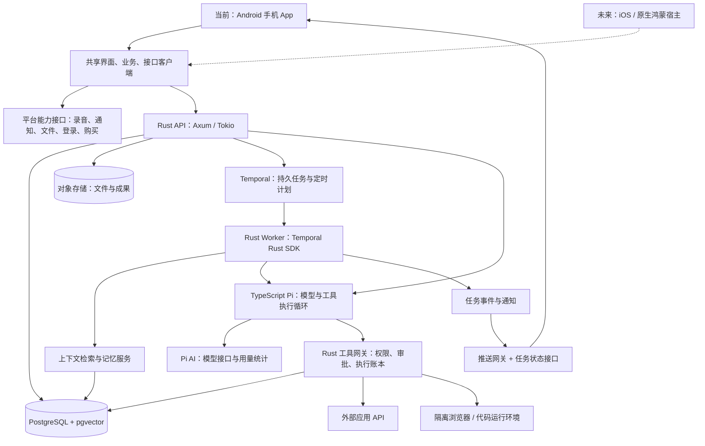

# Tomorrow AI 技术路线与实施计划

版本：v0.5（Rust 业务后端 + Pi，Android 首发，预留 iOS / 原生鸿蒙）
日期：2026 年 10 月 26 日  
当前交付：Android 手机 App + 云端服务；其他手机系统本期仅做迁移验证  
关联文档：[Today.ai 功能梳理与对标范围](./01-today-ai-功能梳理与对标范围.md)

## 1. 路线建议

采用 **Android 手机首发、共享移动客户端、平台能力隔离、云端模块化单体与持久任务编排** 的路线。先把「理解背景 → 提出建议 → 完成任务 → 用户能检查结果」在安卓手机上跑通。后续 iOS 与原生鸿蒙复用云端能力、业务协议及尽可能多的界面和逻辑。

建议核心技术组合：

**React Native + TypeScript 共享客户端，Android 用 Kotlin 接入系统能力；云端业务使用 Rust + Axum + Tokio，Agent 执行使用 TypeScript + Pi，Temporal 采用 Rust SDK，数据库通过 SQLx 访问 PostgreSQL / pgvector，文件使用 S3 兼容存储。**

补充组件：使用 **utoipa / utoipa-axum** 生成接口契约、**aws-sdk-s3** 访问文件存储；进入 MCP 接入阶段时采用官方 **rmcp**。现已确定并接入 Pi Agent Core / Pi AI 1.4.0，不再叠加 Rig 执行循环；原有 Rust Provider 仅保留为显式 direct 模式。

Rust 用于核心 API、权限和工具网关、持久调度、连接器与任务 Worker；TypeScript Pi 服务负责上下文组装、模型调用和工具执行循环，通过受认证的内部 HTTP 接口协作。Temporal 负责长时间任务的调度与恢复，不代替 Agent harness。[Pi Agent Core](https://github.com/earendil-works/pi/tree/main/packages/agent)、[Temporal Rust SDK 公告](https://temporal.io/changelog/rust-sdk-generally-available)

未来 iOS 使用 Swift 适配系统能力；原生鸿蒙优先评估 React Native OpenHarmony（RNOH）与 ArkTS 原生宿主。鸿蒙需要独立工程、适配和真机验收，不能把 Android 安装包作为迁移结果。React Native 官方将 OpenHarmony 列为合作伙伴维护的独立平台项目。[React Native 平台说明](https://reactnative.dev/docs/out-of-tree-platforms)

这是本项目的实现建议，不代表 Today.ai 的内部技术栈。客户端不再按 Web 首发规划，也不将桌面端列入本期。首版无需训练基础模型、拆大量微服务或自建通用云电脑平台。

时间预期维持为：**8～10 周交付限范围的 Android 受邀 beta；14～18 周形成可对外小规模试点的 Android MVP**。前提为 4～6 人团队具备移动端/原生适配及 Rust 异步后端经验；首两周完成关键依赖验证。应用商店、OAuth 和第三方审核独立跟踪，iOS/鸿蒙正式发布不包含在这两个节点内。排期不因改用 Rust 自动缩短；若团队需要学习或补齐适配，在第一阶段重新估时。

## 2. 本稿的规划假设

| 事项 | 暂定假设 | 对路线的影响 |
| --- | --- | --- |
| 首发用户 | 个人知识工作者，中文优先，也保留英文界面能力 | 优先日程、邮件、资料、会议与研究 |
| 首发平台 | 仅 Android 手机 App | 本期交付安卓安装与运行体验；云端服务继续独立部署 |
| 未来迁移 | iPhone / iOS 与原生 HarmonyOS | 现在设适配接口并做最小验证，未来分别打包、签名、审核 |
| 核心后端 | 已确定使用 Rust；API 与任务 Worker 分进程部署 | 通过稳定协议连接各手机端，不要求前后端使用同一种语言 |
| 选型偏好 | 核心业务、协议接入和工具组件优先 Rust | 结合功能覆盖、成熟度与维护成本；保留有利于三端迁移的客户端和适用基础设施 |
| 服务生态 | 首批 Google Calendar / Gmail，随后选定 Drive 文件 | 先形成小而完整的连接器闭环 |
| 地区 | 首发地区未定；核心登录、任务和资料功能不强制依赖 Google 移动服务 | 国际/国内连接器与推送按渠道配置 |
| 团队 | 4～6 人，产品设计、移动端/原生适配、Rust 后端/Agent/连接器、质量运维职责明确 | 需具备 Rust async、数据库与持久任务经验，并有人负责 Android 真机兼容 |
| 负载 | 安卓受邀 beta ≤50 人；试点约 100～500 人 | 不按百万用户预先建设基础设施 |
| 模型 | 首版接入 DeepSeek `deepseek-flash`，通过 Pi 保留兼容接口 | Pi 模式由后端 TypeScript 服务读取模型环境变量，不进入手机端；Rust 不另跑模型循环 |
| 命名 | Tomorrow AI 暂名 | 不影响技术设计 |

Android 首发、Rust 核心后端、预留 iOS 与鸿蒙是已确定约束。其余市场、人数和团队是假设；国内首发、单人开发或未来增加正式平台会改变排期。建议首版 Android 最低版本暂按 Android 10 规划，target API 和设备矩阵在初始化、发布时按依赖及渠道要求锁定。

### 2.1 客户端框架选择

| 路线 | Android / iOS 共享 | 原生鸿蒙迁移 | 本项目判断 |
| --- | --- | --- | --- |
| React Native + TypeScript | 共享主要页面与业务，系统能力由原生模块接入 | 使用伙伴维护的 RNOH，额外验证宿主、引擎和依赖 | **优先路线**；共享手机界面与逻辑，使用契约生成的客户端连接 Rust 后端 |
| Flutter + Dart | 官方支持 Android/iOS，可共享界面与业务 | 需 OpenHarmony 生态适配分支与插件，不能视作 Google 官方支持 | 备选；若 RN 的关键能力验证失败或团队更熟悉 Flutter，再比较迁移成本 |
| Kotlin / KMP | Android/iOS 可共享逻辑或部分 UI | 官方支持表未列原生鸿蒙，需额外方案 | 不作为本项目三端共享的默认方案 |

支持范围依据：[React Native](https://reactnative.dev/docs/out-of-tree-platforms)、[Flutter 支持平台](https://docs.flutter.dev/reference/supported-platforms)、[Kotlin Multiplatform](https://kotlinlang.org/docs/multiplatform/supported-platforms.html)。框架共享不等于每个第三方插件均支持三端。

**第一阶段的选型验证**：用相同业务代码在 Android 真机运行，并在 iOS 环境、原生鸿蒙真机或可用验证环境完成最小样例：登录回调、流式文本、任务恢复、文件选择、录音与通知中的关键桥接。记录未具备环境/权限的项目，不能算通过。锁定 RN / RNOH / React / 引擎 / 原生 SDK / 必选库的可兼容版本组合，生产不直接跟随探索分支。[RNOH 项目](https://atomgit.com/CPF-RN/ohos_react_native)

本期验证只检查可迁移性，不实现其他平台完整功能。如果 RNOH 的关键原生能力无法满足要求，保底采用 ArkTS / ArkUI 实现鸿蒙客户端，继续复用云端、协议、设计与测试用例，允许该端重做界面和适配层；不承诺固定代码复用比例。

Android 首版的图标、助手球与背景渐变集中在 `apps/mobile/src/ui/visuals.tsx`，使用锁定的 `react-native-svg 15.15.5`；未来 iOS、RNOH 需分别验证该原生依赖，必要时替换该模块的渲染实现。Android 11 及以上的键盘避让由原生宿主根据 IME 区域处理，Android 10 保留系统窗口缩放；业务页面不直接读取 Android API。iOS 与鸿蒙继续通过各自宿主适配键盘、安全区和系统能力。

## 3. 目标架构



Rust API 与 Worker 采用同一 Cargo workspace 中的模块化代码库，复用领域逻辑、连接器、持久化和契约模型；分别构建、部署和扩容。手机请求保存意图并取得任务 ID，长任务交给云端持久任务系统；App 不常驻运行 Agent。断线或进程重建后，通过任务 ID、资源版本和事件序号恢复。未来新增客户端连接同一后端，无需迁移任务和记忆数据库。

前台通过 HTTPS 与可恢复事件流更新界面；传输层先验证三端依赖，必要时用同一游标协议短轮询降级。App 进入后台后不依赖永久长连接，推送只作为提醒；重新打开时回查云端状态。离线可查看已缓存内容和保存草稿，未获得云端任务 ID 的请求显示“待提交”。

### 3.1 主要选型与取舍

| 层次 | 选择 | 主要原因与边界 |
| --- | --- | --- |
| 移动客户端 | React Native、TypeScript，共享页面/领域逻辑，原生能力通过接口注入 | Android 首发，未来 iOS / RNOH；导航、动画、富文本等依赖先做兼容验证 |
| 平台适配 | Kotlin；未来 Swift / ArkTS | 录音、推送、文件、权限、安全存储与购买由平台实现，页面不直接依赖平台 SDK |
| 本地数据 | 经兼容验证的 SQLite 封装 + 系统安全存储 | 保存草稿、任务缓存和待上传队列；令牌不放明文数据库，不以本地副本作为业务真相 |
| API 契约 | utoipa / utoipa-axum 生成 OpenAPI，版本化事件 Schema，生成的 TypeScript 客户端 | Rust 与 TS 通过协议协作；契约生成不代替服务端参数、权限和业务校验 |
| API | Rust + Axum，Tokio 异步运行，Tower 系列中间件 | 将身份、来源、记忆、任务、工具分模块，配置超时、请求大小和并发限制 |
| 长任务 | Temporal + 官方 Rust SDK，优先评估托管 | Rust Workflow / Activity / Worker 管理等待、恢复、定时和取消 |
| 数据访问 | SQLx 连接池、参数化 SQL、数据库迁移；pgvector Rust 适配启用 SQLx 支持 | 锁定兼容版本；业务记录和来源权限集中管理 |
| 业务与检索 | PostgreSQL、全文检索、pgvector | 检索和索引继续在数据库侧实现，初期避免独立向量库 |
| 文件 | S3 兼容服务 + aws-sdk-s3，封装内部 Storage 接口 | 支持短时签名、分片直传和恢复；原件、解析内容、成果分开，供应商兼容性单独验收 |
| 缓存 | 首版按需；Rust 进程内缓存/软限流可评估 Moka / governor，共享需求再评估 Redis | 多副本全局预算、任务与审批仍以持久业务记录为准；不默认加入所有缓存组件 |
| Agent / 模型网关 | 独立 TypeScript 服务 + Pi Agent Core / Pi AI 1.4.0 | Pi 管循环与模型；Rust 管用户、状态、审批、业务事务和操作回执，不建立两套业务真相 |
| 工具 | Rust 工具网关；MCP 阶段采用官方 rmcp | MCP SDK 管协议，产品网关管权限、审批与预算；外部工具不获得自动授权 |
| 浏览器 | 独立隔离浏览器服务，可采用 Playwright 执行器 | Rust 网关通过受控接口调用，自动化与隔离分层建设 |
| 文件处理 | Rust Activity 调用适用解析库，特殊格式使用隔离辅助进程 | 文件处理辅助进程与 TypeScript Pi 服务分工独立；核心业务与持久任务调度保持 Rust |
| 观测 | Rust tracing、指标及经验证的 OpenTelemetry 接入 | 记录任务耗时、费用和版本；SDK 特定观测功能先确认稳定性 |

选型依据：[Axum](https://github.com/tokio-rs/axum)、[Tokio](https://tokio.rs/tokio/tutorial)、[SQLx](https://github.com/transact-rs/sqlx)、[pgvector Rust / SQLx](https://github.com/pgvector/pgvector-rust#sqlx)。精确版本、feature 与构建工具在第一阶段验证后锁定。

不把 Expo Go、EAS 或仅有 Android/iOS 实现的 Expo 模块作为三端运行基础；选用任何此类依赖前，必须明确鸿蒙替代或适配方案。[Expo 平台说明](https://docs.expo.dev/core-concepts/)

### 3.2 共享代码与平台代码的边界

| 共享层 | 包含 | 约束 |
| --- | --- | --- |
| 页面与设计 | 每日首页、对话、任务、记忆、设置、主题与组件 | 不在页面到处判断操作系统；平台差异集中在组件/能力适配层 |
| 领域业务 | 任务状态、记忆编辑、审批、自动化规则展示、预算与表单校验 | 不直接使用 Android API、浏览器 DOM 或 Node 专属模块 |
| 数据与接口 | HTTP、事件恢复、上传协议、序列化、本地缓存接口 | 云端 ID 与协议稳定，平台 SDK 返回值先转换为通用对象 |
| 平台能力 | 录音、权限、推送、深链、安全存储、文件、分享、健康、购买 | Android / iOS / 鸿蒙分别实现；返回支持、拒绝、受限等明确状态 |
| 验收资料 | 核心业务用例、接口契约、测试数据、设计变量 | 三端重跑同一业务验收，并增加各自系统测试 |

建议代码组织为共享移动业务包、UI 包、API 客户端、平台接口，以及 Android / iOS / 鸿蒙宿主工程。当前完成 Android 宿主；其他宿主仅保留经验证的最小样例。插件统一通过平台接口使用，避免业务层散布对单个平台库的依赖。ArkTS 原生适配代码单独维护，不假设任意 TypeScript 库可直接在 ArkTS 层运行。

Temporal 工作流中的控制流须可重放；模型、数据库和外部 API 调用放在 Activity 内。工作流升级要有版本兼容策略。[Temporal 工作流说明](https://docs.temporal.io/workflow-definition)

### 3.3 Rust 后端与跨语言契约

- Rust 服务端以契约模型维护 API 和事件 Schema，通过 utoipa / utoipa-axum 生成并评审 OpenAPI，再生成手机端 TypeScript 类型及请求客户端；契约变更随版本保存。
- 时间、ID、金额、枚举、空值、分页和错误码明确序列化格式，避免 Rust 与 JavaScript 数值范围或可空语义不同。新增字段保持向后兼容，手机端容忍未知枚举的降级值。
- 页面只依赖生成的接口及平台适配，不直接引用 Rust 类型或把后端 Rust 编译进 App；iOS/鸿蒙继续复用同一共享客户端与 API。
- Rust 领域代码由 API 与 Worker 共享；模型输出、外部返回和客户端请求都在服务端做运行时验证，编译期类型检查不代替业务授权。

普通异步 API 和 Activity 使用 Tokio。Workflow 内的时间、计时器和并发按 Temporal Rust SDK 的确定性原语实现，不直接使用普通 Tokio 调度、系统时钟、随机数或外部 I/O；重放与升级测试独立验收。[Temporal Rust SDK](https://docs.rs/temporalio-sdk/latest/temporalio_sdk/)

长时间 CPU 处理或阻塞库不占用 API 的异步执行线程；按任务放入有并发限制的阻塞池、独立 Worker 或隔离工具服务。[Tokio 同步代码衔接](https://tokio.rs/tokio/topics/bridging)

接口自动生成采用已有 Rust 工具，减少手动维护路由与文档的重复工作；真实响应、鉴权和运行时校验仍需由服务端实现与验收。[utoipa](https://docs.rs/utoipa/latest/utoipa/)、[utoipa-axum](https://docs.rs/utoipa-axum/latest/utoipa_axum/)

## 4. 从请求到结果的执行闭环

1. **保存请求**：记录会话、附件、用户时区、任务目标和预算，分配任务 ID。
2. **收集上下文**：只检索当前用户有权限访问、仍有效的记忆与来源。
3. **制定有限计划**：简单问答直接回答，多步工作生成任务步骤。
4. **选择工具**：模型提出结构化调用；工具网关检查能力、权限、参数与预算。
5. **准备动作**：只读工作直接执行；需确认的外部写入产生预览。
6. **等待或继续**：工作流持久等待用户批准、补充信息或重新连接。
7. **核实结果**：验证产物可打开、来源可追溯，外部写入得到确认。
8. **回报并更新**：保存结果、发出必要通知；只从可靠结果中提取记忆候选。

当前 Pi 默认最多 10 轮模型请求、20 次工具调用、100 秒、单进程同时 4 次执行；达到限制明确失败并保留已提交操作。记录真实 Token 用量，尚未实现金额预占和全局费用上限。任务强制等待用户在详情确认，计划先保存未启用草稿。后台任务只读，暂不递归派发或执行新写入。

当前模型内部流式接收，手机仍为整轮 JSON 回复；执行记录、取消和恢复协议见 [Pi 服务说明](../services/agent/README.md)。恢复采用限时执行权、同请求重试与事务操作回执，并非 Pi 内部状态的完整 checkpoint 回放。Pi 模式的 Worker 依赖在线 Rust API 工具网关。

不要把模型输出的“完成”当成任务完成。完成条件由任务类型定义：报告要有可访问产物，日历要有外部事件 ID，草稿要有保存记录。

### 4.1 任务状态

```text
queued → running
queued → cancelled
running → waiting_approval / waiting_input / waiting_connection
waiting_* → running
waiting_* → cancelled
running → succeeded / failed / cancelled / uncertain
```

`uncertain` 表示外部动作可能已发生，但响应不足以判断。此状态需要查询或人工核实。取消与暂停不是同一回事：暂停计划阻止未来触发，停止当前任务另行操作；已经发生的外部动作不能自动视作撤销。

取消后立即阻止新步骤；工具写入前再次检查取消标记、授权和计划版本。已经发出的外部请求仍需核实结果，不能仅因用户取消就显示“未发生”。

## 5. 数据模型与租户边界

| 对象组 | 核心字段或关系 | 主要服务功能 |
| --- | --- | --- |
| User / Workspace / Membership | 用户、租户、角色、语言、时区 | F01、F19 |
| Conversation / Message / Attachment | 会话、消息、附件、来源、模型版本 | F03 |
| SourceDocument / Chunk / SourceACL | 外部来源 ID、版本、权限、分块、同步时间 | F08、F09 |
| MemoryItem / Evidence / Revision | 事实类型、来源、有效期、置信度、修订、作用域 | F04 |
| Task / TaskRun / Step / Artifact | 定义、单次运行、步骤、产物、费用 | F06、F10 |
| Schedule | 规则、IANA 时区、版本、下次时间、补跑/重叠策略 | F07 |
| Suggestion / TriggerEvent / Feedback | 触发原因、证据、去重键、用户反馈 | F02、F05 |
| ConnectorAccount / Grant / SyncCursor | scope、密钥引用、游标、订阅到期、健康状态 | F08 |
| ActionProposal / Approval / OperationLedger | 动作快照、批准哈希、操作 ID、外部资源 ID、状态 | F06、F08 |
| Recording / TranscriptSegment | 音频、时间戳、说话人标签、摘要、项目关联 | F13 |
| MobileInstallation / PushToken / CapabilityGrant | 安装实例、系统与版本、推送渠道、通知 token、能力与授权状态 | F01、F17、F19 |
| SkillVersion / CapabilityManifest | 固定版本、来源、权限声明、撤回状态 | F14 |
| UsageLedger / Entitlement / Subscription | 模型与工具用量、权益、订阅、限额 | F18 |
| DeletionRequest / Suppression / AuditEvent | 删除进度、禁止重新提取、操作审计 | F19 |

用户资源携带 `tenant_id`，同时记录所有者、版本和生命周期状态。权限校验覆盖数据库、检索、对象存储、缓存、任务、通知和导出。

PostgreSQL RLS 可作为第二道隔离，但应用连接不能使用超级用户、`BYPASSRLS` 或可绕过策略的表所有者权限；后台 Worker 与连接池也必须正确设置租户上下文。[PostgreSQL 行级安全](https://www.postgresql.org/docs/current/ddl-rowsecurity.html)

SQLx 的租户上下文在当前事务内通过事务级设置生效，查询必须沿用同一事务连接；事务结束后自动清除，避免连接池复用造成串租户。迁移使用独立管理身份；不跨模型调用、用户等待或外部 HTTP 请求持有数据库长事务。[PostgreSQL SET LOCAL](https://www.postgresql.org/docs/current/sql-set.html)

## 6. 记忆与上下文路线（F04）

### 6.1 处理链路

**授权来源 → 解析与分块 → 记忆候选 → 去重/冲突检查 → 结构化条目和证据 → 检索 → 回答或建议。**

区分三类信息：用户明确要求记住的事实、从行为中推断的偏好、仅当前任务使用的临时状态。模型推断不能直接变成永不过期的事实；敏感内容需要更明确的用户控制。

条目至少记录：内容、类型、来源、形成时间、有效时间、用户确认状态、被替代关系与版本。用户修正优先；来源冲突时保留差异，不拼成一个貌似确定的事实。检索时排除过期、无权限、已删除或已被替代的内容。

### 6.2 检索选型

先采用全文检索 + 向量相似度 + 时间/来源权重，按业务对象聚合上下文。小数据先用精确检索；增长后根据实测使用 HNSW 等索引。pgvector 的近似检索与过滤组合可能影响召回，必须在租户过滤条件下评测。[pgvector 官方说明](https://github.com/pgvector/pgvector)

中文与中英混合检索单独评测：明确分词、文本标准化和人名/项目别名策略，选用经过验证的分词方案；不默认数据库通用全文配置已满足中文召回。向量模型也用中文、数字与专有名词测试集选择。

暂不建设图数据库。人物、项目和关系用关系表表达；只有出现明确的多跳关系查询瓶颈，再评估图结构。

### 6.3 删除与“遗忘”

- 用户删除后立即阻止该条目进入新检索和上下文组装，并使进行中任务的旧上下文失效、重新取数或停止。
- 在线清理覆盖向量、摘要、缓存、导出与可访问的派生副本，建议设定 24 小时内完成的目标并显示进度。
- 单删记忆与删除原始资料是不同操作。选择遗忘时保存最小的禁止重提取记录，避免下次同步从同一来源重新生成；不在该记录中保留完整敏感正文。
- 断开连接默认停止新同步和执行；历史资料的保留或删除单独让用户选择。
- 备份可先采用最长 30 天保留的产品目标，恢复时先重放删除记录，再开放读取。供应商侧保留期需单独确认，不能用本地删除冒充所有副本已消失。
- 手机收到删除或撤权版本后清理本地缓存、缩略图和待上传副本；敏感内容不写入推送正文。注销时撤销当前安装会话并清理本地密钥和账户数据，其他设备通过版本更新同步失效。

Temporal 历史也可能保存敏感 payload。工作流尽量只传资源引用，正文放可管理的存储；必要的敏感参数通过经验证的转换/编码机制加密，默认序列化不等于加密。日志、搜索属性和错误信息不记录令牌或完整正文；Rust SDK 的编码、解码与密钥轮换在第一阶段验证。[Temporal 数据处理](https://docs.temporal.io/dataconversion)

## 7. 主动性与可靠调度（F02、F05、F07、F17）

### 7.1 主动建议

采用「事件/时间触发 → 轻量规则 → 去重聚合 → 必要上下文 → 模型判断 → 建议卡 → 可选通知」。首版只做晨间简报、晚间回顾、临近截止和日历变更。

每条建议保存触发原因、证据及时间；控制每天通知数量、静默时段、同类冷却和重要性阈值。记录采纳、忽略、关闭原因。先用规则和用户显式设置，积累数据后再优化排序，不先训练推荐模型。

通知与任务各自有状态：生成成功不等于通知送达，送达也不等于已读。首版提供 App 内通知，并完成首发地区/发行渠道的一条 Android 推送通道；未覆盖的渠道回到 App 内查询，不依赖 Google 移动服务完成基础使用。服务端记录推送渠道、设备 token、失效与用户偏好，后续分别增加 APNs 和原生鸿蒙推送适配。

Android 13 及以上的通知运行时权限需在用户理解用途时申请；拒绝后结果仍在 App 内可查，不能反复强制弹窗。[Android 通知权限](https://developer.android.com/develop/ui/compose/notifications/notification-permission)

### 7.2 调度语义

- 自然语言转结构化规则，保存前展示未来三次执行时间。
- 保存 IANA 时区，区分“每天当地 9 点”和“每隔 24 小时”。用户改时区时说明计划是否跟随。
- 明确同一计划是否允许重叠；默认不重叠，避免一个慢任务堆积多次。
- 每日简报仅补最近一次，过期的提醒跳过；发送、交易等副作用不能盲目补跑。
- 编辑或暂停计划递增版本，触发时检查最新版本；既有运行是否停止由用户单独控制。

Temporal Schedule 提供重叠与补跑等策略，应显式配置为产品需要的语义。[Temporal Schedule](https://docs.temporal.io/schedule)

## 8. 连接器、审批与外部写入（F08）

### 8.1 接入顺序

| 批次 | 范围 | 接入深度 |
| --- | --- | --- |
| 受邀 beta | Google Calendar、Gmail | 日历读取与确认创建；邮件读取与应用内草稿 |
| Android MVP | 加入 Drive 选定文件 | 文件问答与检索；邮件发送仍可后置 |
| 能力增强 | Outlook / OneDrive、Notion、Slack 等高频项 | 分别评估只读、同步和写入，不承诺统一能力 |
| 多端与本土化 | 健康数据、消息渠道、飞书/钉钉等 | 依据平台授权和实际首发市场调整 |

连接器完成标准包括认证、增量同步、权限变更、撤销、刷新失败、限流、监控与删除处理。Google 离线授权和敏感/受限 scope 审核从第一周开始；有些 scope 还可能涉及安全评估。外部审核时间不作为工程可控承诺。[Google OAuth Web Server](https://developers.google.com/identity/protocols/oauth2/web-server)、[OAuth 政策](https://developers.google.com/identity/protocols/oauth2/policies)

产品账号与 Google 连接器授权分离：用户不连接 Google 仍可登录、聊天和上传资料。手机授权通过系统浏览器与注册的安全回跳完成，公共客户端按适用流程使用 PKCE，不在 App 内放客户端密钥；云端长期连接器凭据仍由服务端保管。iOS 和鸿蒙分别注册客户端/回跳并验证，不能直接沿用 Android 原生登录 SDK。[OAuth 原生应用最佳实践](https://www.rfc-editor.org/rfc/rfc8252)

Gmail 通知只提示变化，需要用 `historyId` 拉取增量；watch 至少每七天续订，官方建议每日续订。游标失效时需要受控重同步；Calendar 也要处理过期同步令牌。通过定期对账补偿漏通知，重同步不能恢复用户已要求遗忘的内容。[Gmail Push](https://developers.google.com/workspace/gmail/api/guides/push)、[Gmail 同步](https://developers.google.com/workspace/gmail/api/guides/sync)、[Calendar 错误处理](https://developers.google.com/workspace/calendar/api/guides/errors)

Webhook 接收端按供应商机制验证身份或签名，保存事件 ID 去重，快速确认接收后异步处理。重复、乱序与伪造通知均纳入测试，通知内容不能直接成为用户批准。

### 8.2 审批边界

| 动作 | 首版策略 |
| --- | --- |
| 读取授权资料、生成应用内草稿 | 授权范围内执行 |
| 创建/改动日历事件 | 展示日期、时区、参与人和改动后确认 |
| 真正发送邮件 | P1；收件人、正文、附件完整预览后批准 |
| 固定例行任务 | 可授予有范围、额度和期限的长期批准 |
| 动态外发、交易、永久删除 | 独立审批或暂不支持，不被通用开关放行 |

批准绑定动作快照哈希、用户、账号、工具、目标与有效期。内容、参与人、附件或资源版本变化时重新检查。用户的记忆偏好、邮件正文和网页指令均不能作为授权证据。

### 8.3 防止重复副作用

持久任务可以恢复，但外部操作不会自动获得“只发生一次”的保证；Temporal Activity 可能被重试。[Temporal Activity](https://docs.temporal.io/activity-definition)

实施协议：

1. 在数据库保存不可变提案和稳定 `operation_id`；重试沿用相同 ID。
2. 使用执行账本、事务出站记录和并发锁，调用前重新检查权限与批准。
3. 外部系统支持幂等键或自定义资源 ID 时，传入稳定值。
4. 保存外部资源 ID 和响应，回查后再报告成功。
5. 若请求超时且结果不明，进入 `uncertain`，先核实再决定是否重试。

Calendar 支持客户端提供事件 ID，可用于避免响应丢失后的重复创建。Gmail 发送接口没有同类通用幂等键，不能承诺相同保证；Message-ID 可辅助回查，但查不到不足以证明未发送。[Calendar 创建事件](https://developers.google.com/workspace/calendar/api/guides/create-events)、[Gmail 发送接口](https://developers.google.com/workspace/gmail/api/reference/rest/v1/users.messages/send)

## 9. Android 系统能力与未来迁移（F01、F03、F11～F19）

### 9.1 云端浏览器与代码

P0 通过受控搜索/抓取服务和已知工具完成任务。P1 才开放隔离浏览器，先以公开网页读取和可审查成果为主。

优先采购经过评估的隔离运行时，每次运行配置 CPU、内存、超时、下载大小和网络出口限制。阻断内网及云元数据访问；不挂载宿主机目录；浏览器会话、截图和下载文件按用户隔离并设置保留期。生产环境执行不可信内容需要独立安全边界；Playwright 默认 Docker 镜像面向开发测试，不能直接当成生产沙箱。[Playwright Docker](https://playwright.dev/docs/docker)

长期 OAuth 令牌由密钥管理服务加密保存，经工具网关按次使用，不进入模型上下文或通用执行环境。网页、邮件和文件都是不可信输入；工具权限由服务端强制执行。

登录、验证码和额外授权通过用户接管完成。操作轨迹和停止按钮必须可见。自建 microVM 平台仅在采购方案不满足成本或隔离要求后立项。

### 9.2 Skills

先做官方声明式模板：输入、步骤、工具清单、所需权限和预算。安装固定版本，更新需要重新检查权限，支持撤回。模板不能绕过审批或读取其他租户数据。

MCP 连接采用官方 Rust SDK rmcp，避免自行实现协议与传输。OAuth 凭据、工具授权、网络访问、批准和执行账本继续由产品工具网关控制；只有确需接入 MCP 时才加入相应模块与 feature。[MCP 官方 Rust SDK](https://github.com/modelcontextprotocol/rust-sdk)

社区上传、任意代码、依赖安装和开放网络访问，需要审核、隔离执行、来源签名、版本管理与紧急禁用机制，单列后续里程碑。

### 9.3 平台能力接口与迁移矩阵

| 接口 | Android 首发实现 | 未来 iOS | 未来原生鸿蒙 |
| --- | --- | --- | --- |
| AudioCapture | Kotlin 录音、麦克风授权、中断处理 | Swift 录音与音频会话 | ArkTS 录音与连续任务能力，按目标 SDK 验证 |
| BackgroundTransfer | 系统允许的上传与重试、进程恢复 | 系统后台传输与任务机制 | 系统上传/后台机制；不沿用 Android Worker |
| Notifications | 首发渠道选 FCM 或厂商/HMS 等适用通道，统一后端接口 | APNs 与通知权限 | 原生 Push Kit 适配，独立凭据和 token |
| Files / Sharing | 系统文件/图片选择器、内容 URI、导入导出和分享 | 平台文件访问范围与分享 | 鸿蒙文件选择、沙箱与分享 |
| Auth / SecureStorage | 系统浏览器授权、安全回跳、系统安全存储 | 平台登录入口与 Keychain | 鸿蒙授权回跳与系统安全存储 |
| HealthSource | P1 按设备条件评估 Health Connect 等 | 迁移时单独适配 HealthKit | 按可用健康服务、合作资格和授权评估 |
| Billing | P1 依据选定市场的购买渠道接入，后端验证权益 | 单独接入该发行渠道购买与恢复 | 单独接入该发行渠道购买与恢复 |
| DeviceActions | 分享、打开链接、选择文件等明确动作 | 平台支持的对应动作 | 平台支持的对应动作 |

接口返回支持、未授权、暂时不可用、平台不支持等状态，由共享业务层决定提示和降级。云端健康数据统一类型、单位、时间与来源，但不把一个系统的原始字段当作三端共同格式。

原生鸿蒙通知适配参考其独立的 Push Kit 接入、权限与 token 流程，不直接复用 Android HMS SDK。[鸿蒙 Push Kit 文档](https://developer.huawei.com/consumer/cn/doc/HarmonyOS-Guides/push-appendix)

本期不做桌面配对、任意 App 控制、默认读取短信/通话或依赖全局无障碍权限的自动化。应用商店、签名、推送和付费能力独立验收；Android 兼容设备与原生鸿蒙是两条分发路径。

### 9.4 Android 后台与弱网

云端负责所有 Agent 长任务、计划与重试。Android WorkManager 只用于适合延迟执行的上传重试、缓存同步等本地工作，不能承担“每天 8 点必达”的云端简报调度。系统省电、强制停止和网络变化均纳入测试。[Android WorkManager](https://developer.android.com/develop/background-work/background-tasks/persistent)

上传使用本地持久队列、分片/断点、内容校验与稳定提交 ID；操作请求区分未提交、已接受和结果不明。切换 Wi-Fi/移动网络、重试或重复点击不会重复产生业务任务。敏感本地文件限定保留时间，缺少权限时允许用户重新选择或取消。

推送点击携带资源标识，App 登录并鉴权后再拉内容；安装实例和 token 变化时更新绑定。通知延迟不影响任务事实，不能依靠静默推送让手机持续运行模型或后台录音。

### 9.5 手机录音与办公成果

P0 提供用户主动开始的短语音录制与云端转写；P1 增加长录音/音频导入、时间戳、说话人分段、可编辑文本与摘要追问。说话人分段和声纹识别是不同能力，不自动把标签对应为真实姓名。录音原文作为事实依据，记忆只补充背景。

Android 录音从前台用户操作开始；长录音需要符合目标系统要求的麦克风前台服务、通知和权限。验收锁屏、来电、蓝牙切换与存储不足；不默认采集电话或任意其他应用音频。Android 对前台服务类型和麦克风启动时机有明确限制。[Android 前台服务类型](https://developer.android.com/develop/background-work/services/fgs/service-types)

会前提醒先用普通通知和 App 内入口，未来 iOS 的 Live Activity 等增强单独实现。办公成果先覆盖常用报告与表格，分别验证手机预览、下载和系统分享。

Markdown 优先使用经验证的安全渲染组件；HTML 放隔离 WebView 并清洗，限制导航、脚本、原生桥和文件访问，不共享 App 登录态或敏感凭据。文件下载与分享前重新鉴权，临时访问权限及时回收。

## 10. 里程碑与人员计划

以下为从启动日起的相对周次。P0/P1/P2 对应功能文档；当前交付均指 Android 手机 App 与云端服务，正式 iOS/鸿蒙迁移另行立项。

| 时间 | 目标 | 范围与退出条件 |
| --- | --- | --- |
| 第 1～2 周 | Android 原型与 Rust 技术底座验证 | Today 安卓走查、手机原型、数据/权限模型；RN/RNOH 与 iOS/鸿蒙最小样例；Rust API/SQLx/pgvector、Temporal 定时/审批等待/重试/取消/重放/加密验证；提交 OAuth 审核 |
| 第 3～6 周 | 安卓与 Rust 后端首个纵向闭环 | 签名测试包、基础账号、对话、短语音/文件、记忆、搜索；Rust API 与 Worker 独立运行，通过生成的客户端取得可检查成果 |
| 第 7～10 周建设，第 8～10 周交付 | Android 受邀 beta，≤50 人 | Gmail/Calendar 读优先、简报、定时、App 内通知、一条适用推送通道、有限日历确认写入；权限拒绝与任务恢复可处理 |
| 第 11～14 周 | 完成 P0 广度 | Drive 选定文件、上传重试、计划管理、记忆及本地缓存删除、用量、连接器运维；弱网和进程回收验证 |
| 第 14～18 周 | 对外小规模 Android MVP | 核心端到端场景、主流真机兼容、后台/推送/录音检查、备份恢复、签名分发与回退机制通过；外部审核允许上线 |
| 第 19～26 周 | P1：Android 能力增强 | 长录音与会议摘要、更多成果格式、受限云浏览器、邮件批准发送、少量新连接器、Skills 模板、选定 Android 健康数据源、按渠道订阅；分别发布 |
| 未来单独排期 | P2：iOS / 原生鸿蒙迁移 | 复用共享页面与业务，分别补齐系统能力、签名、商店和回归测试；不占当前 Android 首发范围 |

第 14～18 周的节点指稳定的 P0 Android 试点，并不包含全部 P1。若完整会议录音或云浏览器是首要卖点，应与其他能力交换优先级，重新排期。iOS 构建/签名需要可用的 macOS/Xcode 环境；鸿蒙验证需要匹配 SDK、签名与设备，相关准备在第一阶段记录。[React Native 开发环境](https://reactnative.dev/docs/set-up-your-environment)

建议人员分工：产品/设计 1 人，RN/Android 原生能力 1 人，Rust 后端/Agent/连接器 2 人，移动测试/基础设施 1 人；第 6 人用于原生适配或连接器。后端负责人需熟悉 Rust 异步、SQLx/事务及持久工作流。4 人团队需合并职责并减少并行能力，第一阶段按验证结果校准排期。

Android 后续能力以真实使用价值排序，先做好前 5～10 个高频服务。全部 55 项竞品目录、开放技能生态和未来平台发布不作为当前工期承诺。迁移时依据第一阶段记录的共享代码、原生缺口、商店和合作资格单独估算，不将“可复用”折算成固定缩短比例。

## 11. 验收与质量门槛

下面是本项目拟定目标，尚未实测达成。工作流成功要求产物、权限、动作结果与预算同时满足标准。

| 维度 | 首轮验收方式与目标 |
| --- | --- |
| 核心使用闭环 | 6 类场景各 20 个固定用例；Android 受邀 beta ≥85% 成功，Android MVP 目标 ≥90%；分别报告模型、权限、连接器失败 |
| 来源与事实 | 100 个固定资料问答人工盲评；关键结论能被所引来源支持，证据不足时明确说明 |
| 记忆 | 覆盖正确提取、旧信息、矛盾、用户修正、删除和禁止重新提取；零跨用户召回 |
| 调度 | 10,000 次触发测试，包含多时区/夏令时、重叠、暂停与补跑；受控负载下 p95 开始延迟 ≤60 秒 |
| 故障恢复 | 杀 Worker、重复通知、限流、游标过期、撤销令牌后，状态可解释且可恢复 |
| 外部写入 | 注入“供应商成功但响应丢失”；支持幂等的动作不重复，无法确认的动作进入 uncertain |
| 审批与权限 | 改正文/收件人/附件/账号、审批过期均不能复用旧批准；外部指令不能扩大工具权限 |
| 租户隔离 | 数据、文件、检索、后台任务、导出、签名链接均有越权用例；发现泄露阻止发布 |
| 删除与备份 | 删除立即退出后续上下文，在线副本清理有进度；恢复后删除记录仍有效 |
| 手机界面 | 真机逐项走查空状态、错误、长内容、键盘、安全区域、系统返回、字体放大和深色模式；状态与任务一致 |
| 生命周期与弱网 | 锁屏、前后台、进程回收、强制停止后重开、网络切换和重复点击；已提交云任务延续、草稿可恢复且不重复提交 |
| 权限与手机能力 | 麦克风/通知/文件拒绝或撤销、来电/蓝牙中断、缓存清理、上传续传和分享回流均有测试 |
| 推送与兼容 | 首发推送渠道、点击回任务、token 变更、延迟/关闭通知、厂商省电与无 Google 移动服务的基础功能可验证 |
| 可迁移性 | 共享领域代码不引用 Android 专属 API；平台接口有契约；iOS/RNOH 最小样例记录版本和真实结果，未测项单列 |
| 跨语言接口 | Rust Schema、OpenAPI、生成的 TS 客户端与真实响应一致；覆盖可空、时间、ID、枚举、错误码及旧 App 兼容 |
| Rust 持久执行 | SDK 版本锁定，历史可重放；审批等待、定时、取消、编码与恢复通过；不将普通 Tokio 调度带入 Workflow |
| 资源与负载 | 分别测 API、模型等待、数据库、任务排队；记录并发流式连接、p95/p99、CPU、内存及连接池使用，按试点结果定容量 |
| 安装与质量 | 签名、更新、数据库升级、崩溃/ANR、启动与长列表流畅度、电量和流量有真机基线；清单外系统权限不能混入发行包 |
| 主动建议 | 统计采纳率、误报、重复、通知关闭率，先建立基线再设优化阈值 |
| 单位成本 | 每类任务记录完整 token/工具/沙箱/重试用量，有每任务与每用户限额 |

测试集中在权限、持久任务、外部副作用、数据生命周期与核心产品流程；低风险样式修改用界面检查，不机械增加重复测试。

## 12. 成本模型与预算控制

### 12.1 估算公式

```text
月运行成本 = 固定基础设施
           + 各类任务次数 × (模型费 + 搜索/工具费 + 沙箱费 + 语音费)
           + 存储、流量、日志与观测
           + 同步、记忆提取、主动扫描等后台成本
           + 重试增加的实际用量

模型费 = 输入 token / 1,000,000 × 输入单价
       + 输出 token / 1,000,000 × 输出单价

开发投入 = 各岗位投入人月 × 对应全成本人月单价
         + 真机/设备测试、签名分发、构建环境和必要的平台适配成本
```

模型费应统计一个任务中的全部模型调用与上下文重发。缓存优惠、供应商费率和工具计费在采购时确认，不在本稿中给出未经核价的总报价。

### 12.2 可替换的负载演算

以下只是容量假设，未代入厂商报价：

| 输入项 | 演算值 |
| --- | --- |
| 月活 / 日活 | 1,000 / 200 人 |
| 每日活跃用户手动任务数 | 10 次 |
| 月手动任务量 | 200 × 10 × 30 = 60,000 次 |
| 每月活用户每日自动任务数 | 1 次，包含离线用户仍运行的计划 |
| 月自动任务量 | 1,000 × 1 × 30 = 30,000 次 |
| 月用户任务总量 | 90,000 次 |
| 每任务平均全部输入 / 输出 | 6,000 / 800 token |
| 月输入 / 输出 | 5.4 亿 / 7,200 万 token |
| 浏览器任务比例 / 平均时间 | 10% / 2 分钟 |
| 月沙箱时长 | 18,000 分钟，即 300 小时 |

此外另加来源同步、向量化、后台建议、转写、重试与固定服务费用，不能把上表视作总成本。重度研究任务应单独建模，不能与普通对话共用一个平均数。

成本控制从 P0 开始：任务预算、步骤上限、用户日/月额度、并发上限、低成本模型分流、上下文裁剪、按需启动沙箱，以及租户/工具级停用开关。P1 加入付费订阅时，服务端校验权益与扣量；支付回调去重，退款和降级有明确策略。

Android 还需计入推送供应商、崩溃分析、真机测试、音频传输和应用渠道成本。未来 iOS 增加 macOS 构建与签名环境，鸿蒙增加原生适配和真机验证投入；共享代码主要减少重复开发，不能免除这些成本。

Rust 对应用层 CPU 与内存开销的收益以真实任务压测为准；模型、第三方服务、数据库与沙箱费用继续按实际用量计费，本稿不因语言变化预先下调总成本。

## 13. 主要风险与应对

| 风险 | 对项目的影响 | 路线中的应对 |
| --- | --- | --- |
| 公开信息不完整 | 做出看似相似但操作不同的产品 | 开发第一阶段完成真实账号逐页、逐动作对照 |
| OAuth/平台审核 | 功能完成但无法公开使用 | 第一周提交；受邀测试与公开上线分开管理 |
| 外部写入重复或状态不明 | 重复事件、重复外发 | 执行账本、供应商幂等、回查与 uncertain 状态 |
| 记忆不准确或删除不完整 | 助手持续使用错误/敏感背景 | 来源、修订、权限、禁止重提取与跨副本清理 |
| 网页/文件诱导越权 | 工具被不可信内容驱动 | 服务端权限、审批绑定、隔离执行与凭据代理 |
| 费用失控 | 自动任务与循环产生高成本 | 全链路用量计量、预算、限流、熔断和降级 |
| 鸿蒙兼容假设过强 | RN 依赖、原生模块或 SDK 不能直接复用 | 早期验证 RNOH 版本与必选库；平台能力隔离，必要时保底 ArkTS/ArkUI |
| Rust SDK / 依赖覆盖差异 | 供应商专用 SDK、Temporal 扩展或解析库不覆盖所需功能 | 首两周验证稳定版本与必选特性；优先官方协议适配，必要时用隔离工具执行器补齐，保持 Rust 核心业务 |
| 跨语言契约漂移 | Rust 服务更新后，已发布手机 App 无法正确解析 | 版本化契约、生成客户端与兼容性用例；发布前检查旧 App 行为 |
| 手机后台与推送限制 | 本地上传或通知延迟，用户误以为任务丢失 | 云端任务独立运行；持久队列、状态恢复、推送降级与真机测试 |
| 多端过早并进 | 工程资源分散，Android 核心闭环不稳定 | 本期只交付 Android，iOS/鸿蒙仅验证迁移路径，正式开发另排 |
| 国内外服务可用性差异 | 首发体验与连接生态不匹配 | 市场确定后重排模型、部署、连接器和通知渠道 |

## 14. 已确定约束与后续待定项

已确定：**当前只做 Android 手机；核心后端采用 Rust + Axum / Tokio，任务使用 Temporal Rust SDK；手机端保持 React Native + TypeScript，并为后续 iOS 和原生鸿蒙迁移分离系统能力；云端记忆、任务、连接器和成果保持平台独立。**

后续需要收敛的内容：

1. **首发地区与渠道**：决定推送、账号、连接器优先级与安装分发；中文界面不等同已确定中国大陆市场。
2. **首版卖点深度**：默认记忆 + 每日简报 + 云端执行，短语音首版支持，完整会议录音列 P1。
3. **框架与依赖锁定**：确认 RN/RNOH 与原生 SDK 组合，以及 Rust 工具链、Axum/Tokio、SQLx/pgvector、Temporal Rust SDK 的兼容精确版本和构建锁文件。
4. **投入配置**：暂按具有 Rust 后端与移动端能力的 4～6 人团队；人员减少或关键经验不足时缩范围并重新估时。

下一步可据此产出 Android 页面原型、平台接口定义和开发迭代计划。本轮仅修订文档，尚未创建应用或配置线上服务。

## 15. Rust 优先：替代方案复核记录

复核日期：2026 年 10 月 26 日。以下是结合本项目需求作出的选型判断，尚未运行项目压测或三端真机样例；“有替代品”不代表本项目采用后一定更优。优先使用 Rust 完成业务实现，同时继续满足 Android 首发、未来 iOS 与原生鸿蒙迁移的约束。

### 15.1 已采纳的补充

| 当前空白 | 采用的 Rust 组件 | 收益与验收边界 |
| --- | --- | --- |
| 接口契约生成工具未明确 | utoipa + utoipa-axum | 从 Rust 类型与路由生成 OpenAPI，再生成手机端客户端；必须验证契约和真实请求/响应一致 |
| 文件客户端未明确 | aws-sdk-s3 + 内部 Storage 接口 | 管理分片上传 ID、逐片签名、续签、列片、完成、中止及清理；对实际 S3 供应商验收 |
| MCP 接入实现未明确 | 官方 rmcp，在 MCP 阶段采用 | 复用协议和传输实现；平台授权、审批、费用和幂等仍归产品网关 |

依据：[utoipa](https://docs.rs/utoipa/latest/utoipa/)、[AWS Rust S3 API](https://docs.rs/aws-sdk-s3/latest/aws_sdk_s3/struct.Client.html)、[Rust 签名请求](https://docs.aws.amazon.com/sdk-for-rust/latest/dg/presigned-urls.html)、[rmcp](https://github.com/modelcontextprotocol/rust-sdk)。aws-sdk-s3 是客户端库，S3 兼容存储是服务；更换 SDK 不等于更换存储供应商。

### 15.2 核心框架：保留的原因

| 当前选择 | 核查的替代 | 结论 |
| --- | --- | --- |
| Axum / Tokio / Tower | Actix Web、Poem、Salvo | 保留。替代方案各有优势，现有接口、流式与任务场景未提供更换的实测收益；Axum 可补契约生成而不整体更换 |
| SQLx | SeaORM、Diesel / diesel-async | 保留。ORM 能便利常规实体操作；本项目优先直接控制事务、租户过滤与混合检索，不同时引入多套默认数据访问方式 |
| Temporal Rust SDK | Restate、Apalis、DBOS Rust | 继续采用已确定方案，统一等待、持久重试和恢复；Rust SDK 正式发布时间较短，前期验证仍保留 |
| PostgreSQL / pgvector | Qdrant、LanceDB | 首版保留单库业务与检索。Qdrant 列为独立向量服务的优先扩展候选，待召回/延迟/资源隔离出现实测瓶颈再引入；业务事务仍由 PostgreSQL 承担 |
| 独立 Playwright 执行器 | chromiumoxide、fantoccini | 保留。Rust 库可用于限定浏览器/动作的专项实现，但不能自动替代完整执行能力、调试工具与隔离环境 |

Web 框架依据：[Axum](https://docs.rs/axum/latest/axum/)、[Actix Web](https://github.com/actix/actix-web)、[Poem OpenAPI](https://docs.rs/poem-openapi/latest/poem_openapi/)、[Salvo](https://github.com/salvo-rs/salvo)。数据库依据：[SeaORM](https://www.sea-ql.org/SeaORM/docs/introduction/sea-orm/)、[Diesel async](https://docs.rs/diesel-async/latest/diesel_async/)、[pgvector Rust](https://github.com/pgvector/pgvector-rust)。替代数据库库也支持原生 SQL/向量路径，保留 SQLx 属于本项目取舍。

其他依据：[Temporal Rust](https://docs.temporal.io/develop/rust)、[Restate SDK 状态](https://github.com/restatedev/sdk-rust#versions)、[Apalis workflows](https://docs.rs/apalis-workflow/latest/apalis_workflow/)、[DBOS Rust 介绍](https://www.dbos.dev/blog/whats-new-in-dbos-september-2026)、[Qdrant Rust client](https://github.com/qdrant/rust-client)、[LanceDB](https://github.com/lancedb/lancedb)、[Playwright 支持语言](https://playwright.dev/docs/languages)、[chromiumoxide](https://github.com/mattsse/chromiumoxide)、[fantoccini](https://github.com/jonhoo/fantoccini)。

### 15.3 模型框架、缓存与存储：按需要引入

**模型与执行框架**：本轮确定使用 Pi Agent Core / Pi AI 1.4.0，作为独立 TypeScript 服务接入现有 Rust 后端。Pi 执行模型与工具循环，业务工具通过限时执行能力令牌及服务令牌回调 Rust。工具参数不能指定其他用户；写入与操作回执同事务，相同步骤重试时若改写参数则停止。保留原 Rust Provider 为显式 direct 模式，不并行叠加 Rig 或另一套 Agent 循环。[Pi](https://github.com/earendil-works/pi)、[接入与边界](../services/agent/README.md)

**缓存与限流**：Moka / governor 可作为轻量的 Rust 进程内选项，先用于可重建配置缓存与单实例软限流。跨实例共享状态再考虑 Redis。严格用量通过 PostgreSQL 原子预占和结算，避免每个副本各自放行造成总额超限。[Moka](https://docs.rs/moka/latest/moka/)、[governor](https://docs.rs/governor/latest/governor/)

**对象存储服务**：生产首选满足部署地区、容量与恢复要求的托管 S3 兼容服务。RustFS 已正式发布，列为需要自建时的首要 Rust 候选；采用前验证签名、分片、校验和、Range、删除/生命周期、备份恢复、故障和升级。Garage 保留为特定小规模多地点部署候选。实现语言不代替存储可靠性验收。[RustFS releases](https://github.com/RustFS/RustFS/releases)、[S3 兼容矩阵](https://github.com/rustfs/rustfs/blob/main/docs/architecture/s3-compatibility-matrix.md)、[Garage 兼容性](https://garagehq.deuxfleurs.fr/documentation/reference-manual/s3-compatibility/)

object_store 可在后续确需跨多种云存储统一读写时替换 Storage 的底层实现；当前不与 aws-sdk-s3 同时列为必选。[object_store](https://docs.rs/object_store/latest/object_store/)

### 15.4 手机端是否适合改成 Rust

结论：**本期保留 React Native + TypeScript / RNOH**，Rust 继续用于云端。尚未找到能证明换 Rust UI 后更容易满足三端目标的依据。

| Rust 方向 | 已核实边界 | 当前取舍 |
| --- | --- | --- |
| Tauri 2 | 有 Android/iOS 移动插件体系，官方仓库已有 OpenHarmony 适配分支；正式插件支持表尚未覆盖原生鸿蒙 | 关注其发布与插件成熟度，暂不替换客户端；不能把适配分支等同已验证三端产品底座 |
| Dioxus | 官方移动路线覆盖 Android/iOS；社区有鸿蒙 ArkUI renderer，仍需验证成熟度及两种渲染路径 | 可做独立技术样例，当前不替换 |
| Slint / egui | 存在不同程度的移动支持，但未找到同时覆盖本项目三平台能力的官方完整路线 | 依据具体应用场景另评估，不列为本期手机底座 |
| Rust 共享核心 / UniFFI | Kotlin/Swift 绑定可用；官方 ArkTS 绑定未列明 | 当端上确有加密、复杂离线算法或音频处理需要时再提取，当前不增加额外 FFI 层 |

依据：[Tauri 移动插件](https://v2.tauri.app/develop/plugins/develop-mobile/)、[正式插件支持表](https://v2.tauri.app/plugin/)、[官方 OpenHarmony 分支](https://raw.githubusercontent.com/tauri-apps/tauri/feat/open-harmony/crates/tauri-cli/src/mobile/open_harmony/mod.rs)、[Dioxus 移动指南](https://dioxuslabs.com/learn/0.7/guides/platforms/mobile/)、[社区 ArkUI renderer](https://docs.rs/arkit/latest/arkit/)、[Slint 更新记录](https://github.com/slint-ui/slint/blob/master/CHANGELOG.md)、[egui](https://github.com/emilk/egui)、[UniFFI](https://mozilla.github.io/uniffi-rs/latest/)。以上不改变第 2.1 节要求的三端最小样例与真机验证。

本轮新增的是具体接入库与替代方案记录，P0/P1/P2 功能范围保持不变；精确版本经第一阶段验证后锁定。
